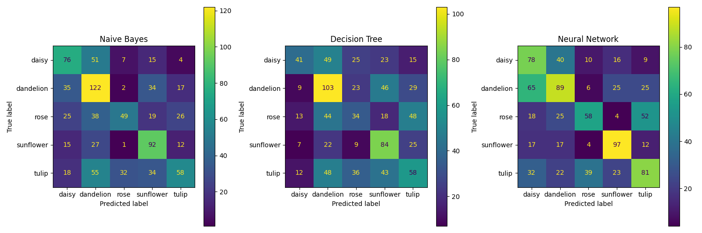
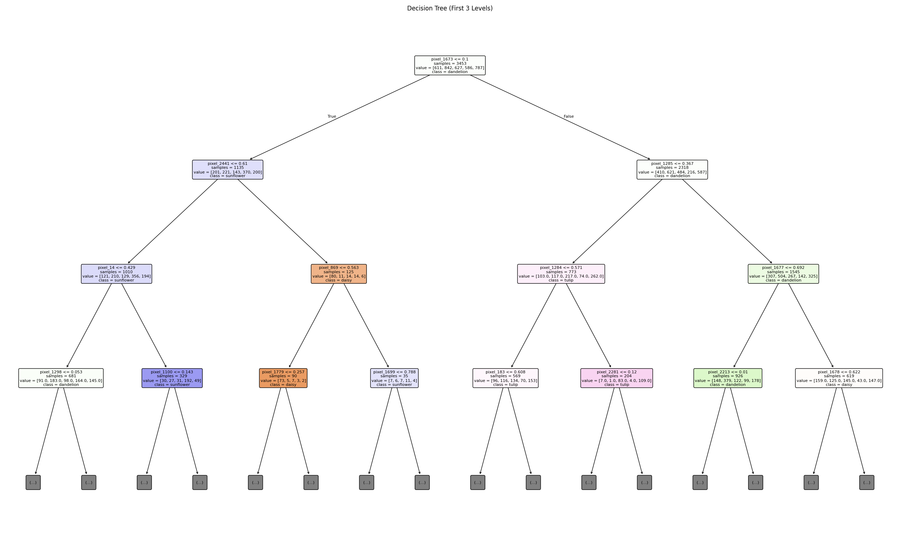

# Flowers Classification ML

Flower image classification comparing three classic machine learning models: Gaussian Naive Bayes, Decision Tree, and a Multi-Layer Perceptron (MLP). Images are classified into five classes using raw pixel features.

## Classes

`daisy`, `dandelion`, `rose`, `sunflower`, `tulip`

## Pipeline

1. **Load**: read images from `flowers/<class>/`, convert BGR to RGB, resize to 32x32, normalize to [0, 1].
2. **Features**: flatten each image into a 3,072-value pixel vector (32 x 32 x 3).
3. **Split**: stratified 80/20 train/test split (`random_state=42`).
4. **Train and evaluate**:
   - Gaussian Naive Bayes
   - Decision Tree (`max_depth=5`, `min_samples_split=10`, `min_samples_leaf=5`)
   - MLP (one hidden layer of 32 units, `max_iter=100`, early stopping)
5. **Report**: accuracy, precision, recall, and F1 per model, plus a side-by-side comparison, confusion matrices, and a decision tree plot.

## Project Structure

```
.
├── main.py                 # Entry point: runs the full pipeline
├── data_preprocessing.py   # Image loading, feature extraction, train/test split
├── models.py               # Model training, evaluation, and plotting
├── decision_tree.png       # Generated decision tree visualization
├── model_comparison.png    # Generated confusion matrices for all models
└── flowers/                # Dataset (one subfolder per class)
```

## Dataset

The code expects this layout:

```
flowers/
├── daisy/
├── dandelion/
├── rose/
├── sunflower/
└── tulip/
```

This repository only includes the `daisy` folder. Download the full Flowers Recognition dataset from Kaggle and place all five class folders inside `flowers/`:

https://www.kaggle.com/datasets/alxmamaev/flowers-recognition

## Requirements

- Python 3.8+
- numpy, pandas, matplotlib, scikit-learn, opencv-python

```bash
pip install numpy pandas matplotlib scikit-learn opencv-python
```

## Usage

```bash
python main.py
```

The script prints the class distribution, per-model metrics, and a final comparison, then saves and displays `decision_tree.png` and `model_comparison.png`.

## Results





## Authors

- Hala Sabobeh
- Nour Omari
